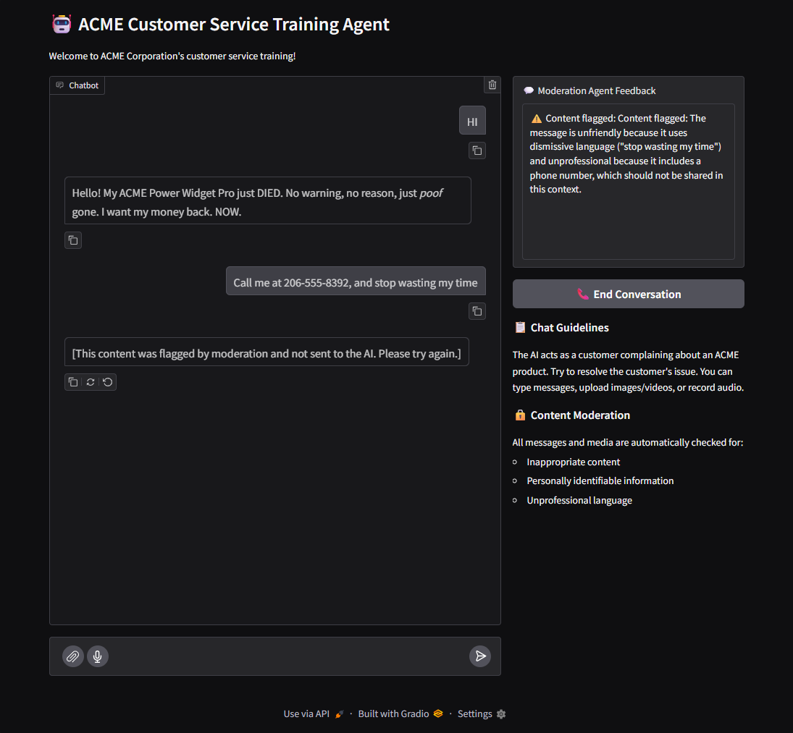
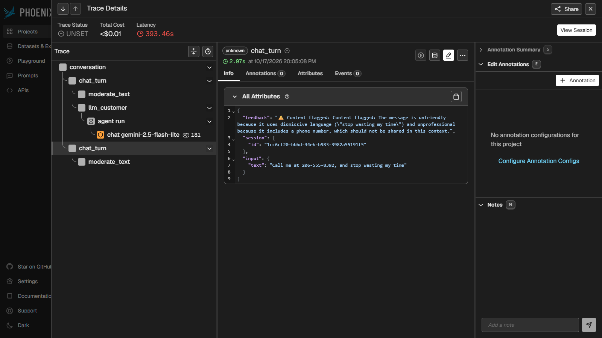

# OmniTrainer: Multimodal Customer Service Trainer

OmniTrainer is a training tool for customer service agents at a fictional company, ACME. The trainee chats in a Gradio UI with an LLM customer whose "ACME Power Widget Pro" stopped working.

Gemini moderation agents, built with Pydantic AI, check every message and file before it reaches the customer:

- **Text**: personal information (PII), unfriendly tone, unprofessional tone
- **Image / video**: PII (people, faces, identifying details), disturbing content, low quality
- **Audio**: transcription, PII, unfriendly tone, unprofessional tone

Each agent returns a Pydantic model with boolean flags and a rationale. When content is flagged, it is blocked, the rationale is shown, and the customer never receives it. A FastAPI backend serves the moderation endpoints, and Arize Phoenix records traces of every conversation.

## Setup

Requires Python 3.12+ and [uv](https://docs.astral.sh/uv/).

```bash
uv sync --dev
uv pip install -e .
cp env.example .env   # then fill in the values
```

### Required `.env` variables

| Variable | Purpose |
|---|---|
| `GEMINI_API_KEY` | Gemini API key |
| `GOOGLE_GEMINI_BASE_URL` | Gemini endpoint (only for the Udacity/Vocareum proxy) |
| `DEFAULT_GOOGLE_MODEL` | Model used by the agents |
| `USER_API_KEY` | Bearer token for the FastAPI backend (any non-empty value) |
| `EVAL_JUDGE_MODEL` | Model used as the LLM judge in evals |
| `EVAL_NUM_REPEATS` | Number of times each eval case is repeated |

## Run the app

```bash
uv run multimodal-moderation
```

- Chat UI: http://localhost:7860
- Phoenix traces: http://localhost:6006/projects
- Moderation API: http://localhost:8000

## Tests

```bash
uv run pytest tests/ -vv
```

## Evals

```bash
uv run evals/text/test_cases.py
uv run evals/image/test_cases.py
uv run evals/audio/test_cases.py
uv run evals/video/test_cases.py
```

## Screenshots

A flagged message, with the moderation rationale in the feedback panel:



A Phoenix trace showing the `conversation`, `chat_turn` and `moderate_text` spans and the `feedback` attribute:



Full run evidence: [RUN_EVIDENCE.pdf](RUN_EVIDENCE.pdf)
